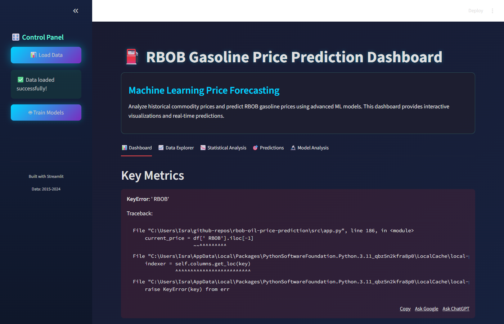

# RBOB Gasoline Price Prediction

[](https://www.python.org/)
[](https://scikit-learn.org/)
[](https://streamlit.io/)
[](LICENSE)

> **Key Finding**: Ridge beats the persistence baseline on average over 5 walk-forward folds (MAE $0.069 vs $0.0848, about 18.6%, 4 of 5 folds) but does NOT beat it on the final holdout of the dashboard pipeline (Ridge 0.0684 vs baseline 0.0562), so the edge is not robust. Tree models underperform.

Time-series forecasting pipeline and interactive Streamlit application predicting next-day RBOB gasoline spot prices using daily energy commodity data (2015-01-02 to 2024-12-31, 2,569 rows).

## Key Modeling Findings

Models are evaluated via 5-fold walk-forward cross-validation (`TimeSeriesSplit`), predicting next-day price ($t+1$) strictly from past and same-day features ($t$ and earlier) to avoid lookahead leakage.

1. **Walk-Forward Generalization**:
   - In the benchmark notebook setup, Ridge Regression achieves a mean MAE of $0.0690/gal ($R^2 = 0.925$), outperforming the persistence baseline in 4 of 5 folds.
   - Non-linear tree ensembles (Random Forest and Gradient Boosting) underperform the baseline in most folds (Random Forest in all 5, Gradient Boosting in 4 of 5). In Fold 4 (2021-2023 energy price volatility), Random Forest MAE degrades to $0.59-$0.63/gal because decision trees cannot extrapolate trends beyond the price ranges observed in training data.
2. **Holdout Evaluation**:
   - On the final holdout split in `src/predictor.py`, the persistence baseline achieves MAE $0.0562, while Ridge achieves MAE $0.0684. The marginal gain observed in walk-forward cross-validation does not persist on every market regime, indicating that day-ahead commodity price predictability is weak and non-stationary.

## Benchmark Results

### Notebook 5-Fold Walk-Forward Evaluation

| Model | Mean MAE ($/gal) | MAE Std | RMSE | $R^2$ | vs. Baseline |
|---|---|---|---|---|---|
| **Ridge Regression** | $0.0690 | 0.0178 | 0.1017 | 0.9246 | **+18.62%** |
| **Persistence Baseline** | $0.0848 | 0.0279 | 0.1269 | 0.8969 | Reference |
| **Gradient Boosting** | $0.1673 | 0.1472 | 0.2372 | 0.6789 | -97.25% |
| **Random Forest** | $0.2372 | 0.1967 | 0.3133 | 0.3591 | -179.76% |

### Standalone Pipeline Evaluation (`src/predictor.py`)

Using the unified `GasolinePredictor` module on 35 engineered features across 2,562 cleaned rows:
- **Baseline (Persistence)**: MAE $0.0562, RMSE 0.0886, $R^2 = 0.9480$
- **Ridge Regression**: MAE $0.0684, RMSE 0.1005, $R^2 = 0.9256$
- **Gradient Boosting**: MAE $0.1312, RMSE 0.2049, $R^2 = 0.7476$
- **Random Forest**: MAE $0.2085, RMSE 0.2842, $R^2 = 0.4791$

## Streamlit Application Architecture

The interactive dashboard (`src/app.py`) provides 5 dedicated views:
1. **Dashboard**: High-level overview of RBOB price trends, summary metrics, and rolling averages.
2. **Data Explorer**: Interactive tables and distribution plots across all 16 tracked energy series.
3. **Statistical Analysis**: Cross-asset correlation matrix, refining margins (crack spreads), and seasonal distributions.
4. **Predictions**: Next-day forecasts, model comparison cards, and actual vs. predicted time-series overlays.
5. **Model Analysis**: Walk-forward cross-validation diagnostics and top feature importance rankings.

## Repository Structure

```
rbob-oil-price-prediction/
├── .gitignore
├── LICENSE
├── README.md
├── requirements.txt
├── data/
│   └── oil_prices.csv
├── notebooks/
│   └── rbob_price_prediction.ipynb
└── src/
    ├── app.py
    └── predictor.py
```

## Getting Started

```bash
pip install -r requirements.txt

# Run the interactive Streamlit dashboard
streamlit run src/app.py

# Or run the prediction engine directly
python -c "from src.predictor import GasolinePredictor; p = GasolinePredictor(); p.train_models()"
```

## Dashboard Preview



## License

This project is licensed under the MIT License - see the [LICENSE](LICENSE) file for details.
